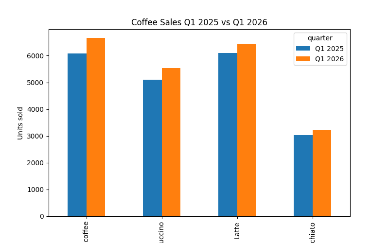
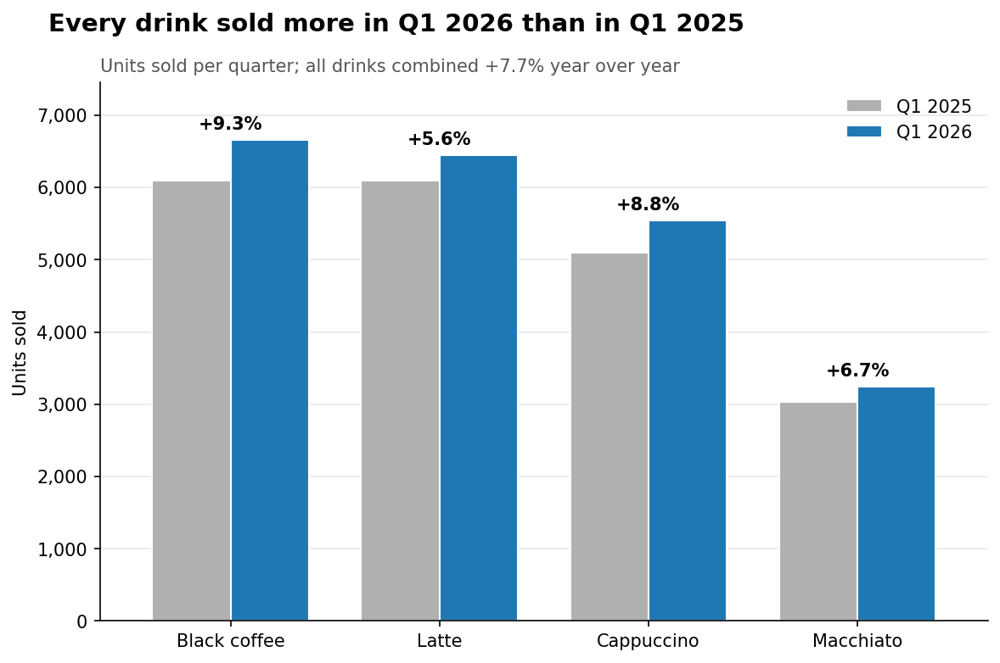
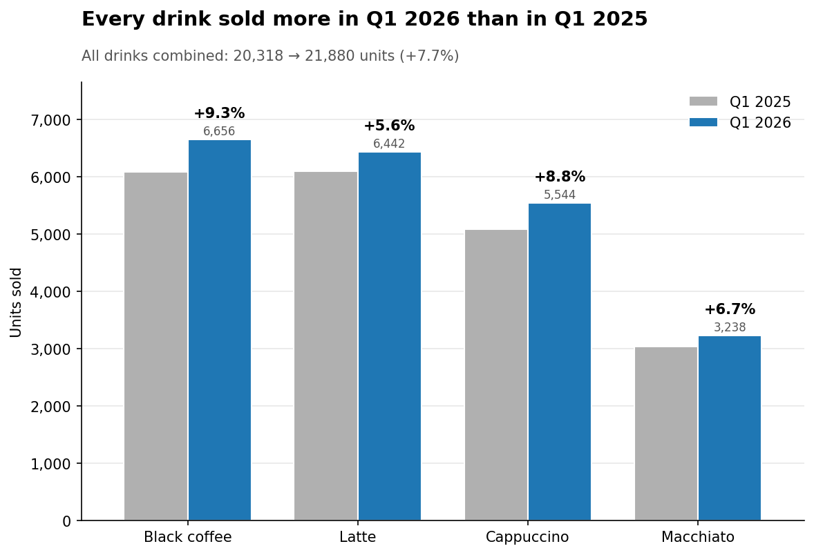

# demo_coffee_sales

A demo of the **reflection pattern** for the Stanford Agentic AI class. One model writes chart code, a second model critiques the rendered chart and its code, and the first model revises. The task is a chart comparing coffee sales in Q1 2025 and Q1 2026. The loop ran for three versions.

## The loop

```
data/coffee_sales_q1.csv
        │
        ▼
 ┌─────────────┐   chart_vN.py    ┌──────────────┐   critique_vN.md   ┌─────────────┐
 │  Generator  │ ───────────────► │    Critic    │ ─────────────────► │  Generator  │ ──► chart_vN+1.py
 │  Opus 5.5   │  + chart_vN.png  │  Fable 5.1   │                    │  Opus 5.5   │
 └─────────────┘                  └──────────────┘                    └─────────────┘
```

| Role | Model | How it runs |
|---|---|---|
| Generator | Claude Opus 5.5 (`claude-opus-5-5`) | Wrote each `chart_vN.py` inside a Claude Code session |
| Critic | Claude Fable 5.1 (`claude-fable-5-1`) | `critique.py` sends the PNG, the source and sample CSV rows in one API call |

The original plan was a weaker generator (Haiku 5.5) paired with a stronger critic (Opus 5.5). The first draft was written by Opus 5.5, so the critic moved up to Fable 5.1 to keep the critic stronger than the generator. The same model wrote every version, so the improvement between rounds comes from the critique, not from a change of author.

## Results

### v1: first draft


> "The numbers look correct … but the rendered image is not presentable: drink names are truncated and the x-axis label is cut off, and the size of the growth—the actual point of the comparison—has to be eyeballed." ([critique_v1.md](critiques/critique_v1.md))

### v2: revised per critique 1


> "The chart does its job … Remaining issues are polish and robustness, not correctness." ([critique_v2.md](critiques/critique_v2.md))

### v3: revised per critique 2 (final)


> "The chart achieves its goal … What remains is polish and one wording/robustness concern." ([critique_v3.md](critiques/critique_v3.md))

| Round | High | Medium | Low | Main fixes in the next version |
|---|---|---|---|---|
| v1 | 1 | 2 | 3 | Unclipped labels, % change per drink, sorting, takeaway title, grey vs blue for the two years |
| v2 | 0 | 2 | 5 | Aligned title, labels anchored to bars, 2026 values shown, totals in subtitle, data-coverage check |
| v3 | 0 | 2 | 5 | *(loop stopped)* |

## Observations

- **The critic never runs out of issues.** Each round returned 6–7 issues. Severity is what changed: layout and message problems in v1, then polish and code robustness in v2 and v3. Use the verdict and the severity, not the issue count, to decide when to stop.
- **A stopping rule matters.** Here the rule was "stop when no high-severity issues remain and the verdict says the goal is met". v2 already met it. v3 was a deliberate extra round to show the diminishing returns.
- **Some critiques recur.** "Sales" can mean units or revenue. The critic raised this in v1 and again in v3. In this mock data the unit prices are the same in both years, so revenue moves the same way as units. A real pipeline would need to settle that question once, in the prompt.
- **The critic checks the numbers.** In v2 and v3 it checked the % labels and totals against the bar heights. That is a correctness check, not just a style review.
- **Cost.** The three Fable 5.1 critiques used 7,278 input and 7,775 output tokens, about **$0.46** in total ($0.12, $0.16 and $0.19).

## Files

| Path | What it is |
|---|---|
| `data/coffee_sales_q1.csv` | Mock daily units sold and revenue per drink for Q1 2025 and Q1 2026 (720 rows) |
| `chart_v1.py`, `chart_v2.py`, `chart_v3.py` | Each version of the chart code |
| `charts/chart_vN.png` | The chart each version produced |
| `critique.py` | The critic: `./critique.py N` reviews version N |
| `critiques/critique_vN.md` | The critic's output for each version |

### The data

The data covers four drinks: Black coffee, Cappuccino, Latte and Macchiato, for 90 days in each quarter. Volumes are limited by staffing. The shop has two baristas and is open 07:30–19:30 every day, and each drink takes 2–8 minutes to make, so a day has 1,440 barista-minutes. Weekends are busier, sales pick up slightly from January into March, and Q1 2026 runs about 8% above Q1 2025.

## Running it

```bash
pip install -r requirements.txt
echo 'ANTHROPIC_API_KEY=sk-ant-...' > .env   # git-ignored
./chart_v3.py        # writes charts/chart_v3.png
./critique.py 3      # writes critiques/critique_v3.md (one Fable 5.1 call, about $0.20)
```

`critique.py` turns on Anthropic's server-side refusal fallback. If Fable declines the request, another model answers. When that happens the script prints a note, and the first line of the critique file records which model actually answered.
